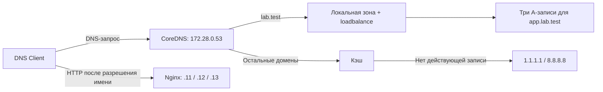

# DNS-сервер с балансировкой нагрузки, кэшированием и перенаправлением запросов

Курсовой проект по **Computer Systems & Networks**. Цель — настроить DNS-систему на базе **CoreDNS**, проверить DNS Load Balancing, Caching и Forwarding, собрать измерения и объяснить результаты.

В репозитории уже подготовлено Docker-окружение: CoreDNS, три Nginx-сервера и отдельный клиент с `dig` и `curl`. Внутренняя зона `lab.test` обслуживается локально, а запросы к внешним доменам перенаправляются на публичные DNS-резолверы.

Этот README описывает текущее состояние проекта и работу, которую нужно завершить команде. **Автоматических тестовых скриптов и сохранённых результатов измерений пока нет — их должны подготовить участники.**

## 1. Что уже сделано

| Часть проекта | Текущее состояние |
|---|---|
| Выбор DNS-сервера | Используется CoreDNS `1.12.0`; выбирать между BIND, Unbound и CoreDNS больше не нужно |
| Docker-инфраструктура | Настроены пять сервисов, общая сеть и фиксированные IP-адреса |
| DNS Client | Есть отдельный контейнер с Bash, `dig` и `curl`, использующий CoreDNS как DNS-сервер |
| Внутренняя зона | Создана `lab.test`, включая `ns.lab.test` и три A-записи для `app.lab.test` |
| Load Balancing | Включён `loadbalance round_robin`; автором начального окружения выполнены повторные запросы и проверено изменение порядка IP-адресов |
| Forwarding | В Corefile уже задано перенаправление на `1.1.1.1` и `8.8.8.8`; нужны проверки и документирование результатов |
| Caching | В блоке внешних запросов уже есть `cache 30`; нужны проверка попаданий в кэш, истечения TTL и сравнение с отключённым кэшем |
| Автоматизация и статистика | Предстоит написать скрипты, провести измерения и оформить выводы |

По исходному распределению автор начального окружения уже выполнил:

- **Из задач участника №3, пункты 1–7:** структура репозитория, Docker Compose, общая сеть, контейнер CoreDNS, три Nginx-контейнера, фиксированные IP backend-серверов и отдельный DNS Client.
- **Из задач участника №1, пункты 1–6:** изучение DNS Round Robin, внутренняя зона, несколько A-записей для `app.lab.test`, настройка изменения их порядка в CoreDNS и ручная проверка повторных запросов.

Эту основу не нужно создавать заново. Следующий этап — автоматизация проверок, экспериментальное подтверждение работы кэша и подготовка результатов для сдачи.

## 2. Быстрый запуск

Нужны Git, установленный и запущенный Docker Engine либо Docker Desktop и Docker Compose с командой `docker compose`. Для загрузки образов, установки пакетов в клиентский образ и проверки внешних DNS-запросов нужен доступ к Интернету.

Все команды `docker compose` ниже выполняются **на хосте из корня репозитория**, где находится `compose.yml`.

```bash
docker compose up -d --build
docker compose ps
```

Ожидается пять запущенных сервисов: `dns-server`, `dns-client`, `backend1`, `backend2`, `backend3`. Запущенный контейнер ещё не гарантирует готовность сервиса: healthcheck в текущей конфигурации не задан.

Открыть Bash внутри клиента:

```bash
docker compose exec dns-client bash
```

**Все команды `dig` и `curl` из разделов 5–7 выполняются внутри `dns-client`.** Устанавливать эти утилиты на хост не требуется.

```bash
cat /etc/resolv.conf
```

Ожидается `nameserver 172.28.0.53`: эта настройка записывается при старте клиента. Для воспроизводимых DNS-проверок ниже дополнительно указывается сервер через `@172.28.0.53`.

Чтобы выйти из клиента:

```bash
exit
```

Остановить окружение и удалить его контейнеры и сеть, сохранив файлы проекта:

```bash
docker compose down
```

## 3. Архитектура и адреса

Все сервисы подключены к bridge-сети `dns-lab` с подсетью `172.28.0.0/24`. При стандартном запуске Compose имя Docker-сети — `csn-final-project_dns-lab`.

| Сервис | IP-адрес | Назначение |
|---|---|---|
| `dns-server` | `172.28.0.53` | CoreDNS, DNS на порту 53 по UDP и TCP |
| `dns-client` | `172.28.0.20` | Debian Bookworm, `dig`, `curl`, Bash |
| `backend1` | `172.28.0.11` | Nginx, HTTP на порту 80, страница Backend Server 1 |
| `backend2` | `172.28.0.12` | Nginx, HTTP на порту 80, страница Backend Server 2 |
| `backend3` | `172.28.0.13` | Nginx, HTTP на порту 80, страница Backend Server 3 |



CoreDNS возвращает адреса; HTTP-соединение клиент устанавливает непосредственно с выбранным Nginx. DNS-сервер не проксирует HTTP-трафик и не проверяет доступность этих backend-серверов. Остановка Nginx сама по себе не удаляет его IP из зоны.

Порты контейнеров **не опубликованы на хост**. Для приведённых проверок используется `dns-client`; команда `dig @localhost ...` на хосте не обращается к этому CoreDNS.

## 4. Файлы и логика конфигурации

```text
.
├── compose.yml                  # Сервисы, сеть, IP-адреса и монтирование файлов
├── dns/
│   ├── Corefile                 # Внутренняя зона, loadbalance, forward и cache
│   └── zones/db.lab.test        # SOA, NS и A-записи зоны lab.test
├── dns-client/
│   └── Dockerfile               # Образ клиента с dnsutils и curl
├── backends/
│   ├── backend1/index.html      # Страница с идентификатором первого backend
│   ├── backend2/index.html      # Страница с идентификатором второго backend
│   └── backend3/index.html      # Страница с идентификатором третьего backend
└── README.md
```

Текущий [Corefile](dns/Corefile):

```text
lab.test {
    file /etc/coredns/zones/db.lab.test
    loadbalance round_robin
}

. {
    forward . 1.1.1.1 8.8.8.8
    cache 30
}
```

- Блок `lab.test` обслуживает внутреннюю зону из файла. Для `app.lab.test` он возвращает три A-записи, перемешивая их порядок.
- Блок `.` обрабатывает остальные домены. При отсутствии действующего ответа в кэше запрос передаётся одному из upstream-резолверов. Само наличие двух адресов не означает отправку каждого запроса обоим серверам. См. [документацию forward](https://coredns.io/plugins/forward/).
- `cache 30` ограничивает время хранения ответа в этом кэше сверху 30 секундами; это не фиксированный TTL для любого ответа. См. [документацию cache](https://coredns.io/plugins/cache/).
- В локальном блоке `lab.test` плагин `cache` не включён. Значение `$TTL 30` в файле зоны задаёт TTL её записей и является отдельной настройкой.

Не следует путать **корень внутренней зоны `lab.test`** и **корневой блок `.`** в Corefile: запросы к `lab.test` обслуживаются локальным блоком, а не внешним forwarding.

## 5. Ручная проверка DNS и Round Robin

### 5.1. Приложение: `app.lab.test`

Посмотреть DNS-ответ с TTL и заголовком:

```bash
dig @172.28.0.53 app.lab.test. A
```

В ответе ожидаются `status: NOERROR`, флаг `aa` авторитетного ответа и три A-записи с адресами `172.28.0.11`, `172.28.0.12`, `172.28.0.13`. Для локального запроса можно добавить `+norecurse`, чтобы не запрашивать рекурсивное разрешение.

Для демонстрации балансировки выполнить одну и ту же команду несколько раз:

```bash
dig @172.28.0.53 app.lab.test. A +short
dig @172.28.0.53 app.lab.test. A +short
dig @172.28.0.53 app.lab.test. A +short
```

Пример возможных результатов, **не сохранённый результат измерения**:

```text
Первый запрос:       Второй запрос:      Третий запрос:
172.28.0.11          172.28.0.12          172.28.0.13
172.28.0.12          172.28.0.11          172.28.0.12
172.28.0.13          172.28.0.13          172.28.0.11
```

Каждый успешный ответ содержит весь набор из трёх адресов. CoreDNS `loadbalance round_robin` **случайно перемешивает записи**, а не обеспечивает строгую последовательность `1 → 2 → 3`. Одинаковый порядок в двух соседних ответах допустим. См. [документацию loadbalance](https://coredns.io/plugins/loadbalance/).

Для статистики нужно считать, какой адрес оказался **первым** в каждом ответе. Подсчёт всех трёх адресов даст одинаковое число для каждого backend и не покажет изменение порядка. На большой выборке доли первых позиций должны приближаться к одной трети, но точное равенство не гарантируется.

Эта проверка показывает распределение порядка DNS-записей. Реальное распределение HTTP-запросов также зависит от поведения клиента и его кэша.

Проверка DNS по TCP:

```bash
dig @172.28.0.53 app.lab.test. A +tcp
```

### 5.2. Корень внутренней зоны: `lab.test`

```bash
dig @172.28.0.53 lab.test. A +noall +comments +answer +authority
dig @172.28.0.53 lab.test. NS +noall +answer
dig @172.28.0.53 lab.test. SOA +noall +answer
dig @172.28.0.53 ns.lab.test. A +short
```

Ожидаемое поведение текущего файла зоны:

| Запрос | Ожидаемый ответ |
|---|---|
| `app.lab.test. A` | Три адреса backend-серверов в переменном порядке |
| `lab.test. A` | `NOERROR`, пустая секция Answer и SOA в Authority: имя существует, но A-записи нет — NODATA |
| `lab.test. NS` | `ns.lab.test.` |
| `lab.test. SOA` | SOA-запись с параметрами зоны и её serial |
| `ns.lab.test. A` | `172.28.0.53` |

`dig lab.test. A +short` поэтому ничего не напечатает. Это ожидаемо: три A-записи созданы для `app`, а не для `@` — вершины зоны.

Для сравнения запрос несуществующего имени:

```bash
dig @172.28.0.53 missing.lab.test. A
```

Здесь ожидается `NXDOMAIN`: такого имени нет в зоне. Это отличается от существующего `lab.test` без записи типа A.

### 5.3. Внешние домены и корневой блок `.`

```bash
dig @172.28.0.53 example.com. A
dig @172.28.0.53 example.org. A
dig @172.28.0.53 . NS
```

Эти запросы обрабатывает блок `.`: ответ поступает из кэша либо через upstream. Для внешних доменов ожидается успешное разрешение; конкретные IP и TTL зависят от внешней DNS-зоны. Запрос `. NS` возвращает NS-записи глобальной корневой зоны через настроенные резолверы.

## 6. Проверка Nginx

Сначала обратиться к каждому backend напрямую:

```bash
curl --fail --noproxy '*' http://172.28.0.11/
curl --fail --noproxy '*' http://172.28.0.12/
curl --fail --noproxy '*' http://172.28.0.13/
```

Ожидаются разные HTML-страницы с текстом `Welcome to Backend Server 1`, `2` или `3` и соответствующим IP-адресом.

Затем проверить доступ по DNS-имени через резолвер клиента:

```bash
curl --fail --noproxy '*' http://app.lab.test/
```

Ожидается страница одного из трёх серверов. Повторные вызовы не обязаны строго чередовать backend-серверы. Успех этого запроса проверяет связку DNS → HTTP, а статистику порядка A-записей нужно собирать отдельно через `dig`.

## 7. Как исследовать кэширование

Базовая настройка `cache 30` уже присутствует. Нужно подтвердить её работу экспериментами и оформить сравнение.

Для наблюдения за TTL и временем ответа выполнить внутри клиента:

```bash
dig @172.28.0.53 example.com. A +noall +answer +stats
sleep 2
dig @172.28.0.53 example.com. A +noall +answer +stats
sleep 31
dig @172.28.0.53 example.com. A +noall +answer +stats
```

Сравнить TTL в строках ответа и `Query time`. Повторные ответы из кэша обычно показывают уменьшение TTL; после истечения срока хранения следующий запрос должен снова обратиться к upstream. Время `0 msec` означает ограниченную точность измерения `dig`, а не отсутствие затрат на обработку.

Первый запрос этой последовательности **не обязательно выполняется при пустом кэше**: туда мог попасть ответ от предыдущих проверок. Для контролируемого эксперимента можно предварительно перезапустить только CoreDNS **на хосте**, затем дождаться его готовности:

```bash
docker compose restart dns-server
```

Это очищает локальный кэш процесса CoreDNS, но не кэши `1.1.1.1` и `8.8.8.8`.

Для завершения исследования требуется:

1. Подтвердить разрешение внешних имён и проверить доступность обоих настроенных upstream.
2. Зафиксировать первый запрос после очистки локального кэша, повторные запросы до истечения TTL и запрос после истечения TTL.
3. Подтвердить попадания в кэш и сокращение обращений к upstream наблюдением за DNS-трафиком либо метриками CoreDNS. Одна лишь разница времени ответа не доказывает cache hit; обычный лог входящих запросов тоже не показывает, был ли ответ взят из кэша.
4. Провести серии примерно по 20–30 измерений с кэшированием и без него при одинаковых условиях. Для варианта без кэша временно убрать `cache 30` из блока `.` и перезапустить CoreDNS; после эксперимента вернуть настройку и снова перезапустить сервис.
5. Сохранить исходные данные, сравнить медианы и описать влияние сетевых задержек, upstream-кэшей и истечения TTL во время серии.

Не нужно отключать кэш для проверки Round Robin: внутренний блок `lab.test` и сейчас не использует плагин `cache`.

## 8. Что осталось сделать

- Написать проверку после запуска: готовность CoreDNS, внутреннее разрешение по UDP/TCP, ожидаемые ответы для `app.lab.test` и `lab.test`, доступность трёх Nginx и HTTP по имени приложения.
- Добавить проверку внешнего разрешения с понятным сообщением при недоступности Интернета или upstream.
- Написать скрипт серии из 50–100 запросов `app.lab.test. A` с возможностью изменить число запросов.
- Проверять DNS-статус и наличие ровно трёх ожидаемых адресов в каждом успешном ответе; ошибки и таймауты учитывать отдельно.
- Сохранять порядок A-записей и первый адрес каждого ответа. Считать количество и долю первых позиций для каждого IP среди успешных ответов.
- Подготовить таблицу или график распределения и выводы. Не требовать строгого чередования или точного равенства долей на малой выборке.
- Описать реализацию и ограничения DNS-балансировки, включая отличие от распределения HTTP-соединений.
- Проверить и при необходимости доработать существующие `forward` и `cache`.
- Написать скрипт проверки внешнего разрешения, повторных запросов и истечения TTL.
- Подготовить воспроизводимое сравнение с включённым и выключенным локальным кэшем по методике раздела 7.
- Сохранять домен, тип запроса, статус, TTL, время ответа и условия эксперимента; отдельно учитывать неуспешные запросы.
- Подготовить результаты, описание конфигурации и объяснение наблюдаемого поведения.
- Подготовить единый сценарий запуска тестов. Он должен ожидать готовность сервисов, возвращать ненулевой код при ошибке и объединять проверки инфраструктуры, балансировки, кэширования и перенаправления запросов.
- Организовать сохранение результатов на хосте, чтобы они не терялись после `docker compose down`.
- Зафиксировать условия измерений: дату, версии образов, конфигурацию, число запросов и интервалы; собрать общую сводку.
- Объединить изменения и провести итоговую проверку всей системы.
- Описать вклад команды, подготовить презентацию и провести репетицию демонстрации.

Предлагаемая структура **для будущего добавления**, этих файлов пока нет:

```text
tests/
├── smoke.sh                  # Проверка окружения после запуска
├── load-balancing.sh         # Порядок A-записей и статистика первых позиций
├── caching.sh                # Cache hit, истечение TTL и измерения
└── run-all.sh                # Общий запуск проверок
results/                     # Исходные CSV/TSV и сводки экспериментов
docs/
├── load-balancing.md
├── caching.md
└── test-results.md
```

Способ доставки будущих скриптов в `dns-client` нужно реализовать отдельно: сейчас каталога с тестами и его монтирования в Compose нет. Скрипты должны явно указывать DNS-сервер, ограничивать время ожидания и различать DNS-ошибку, таймаут и корректный ответ без A-записи.

## 9. Изменение конфигурации и диагностика

Перед запуском проверить синтаксис Compose и посмотреть состояние сервисов:

```bash
docker compose config --quiet
docker compose ps
docker compose logs --tail=100 dns-server
```

`docker compose config --quiet` проверяет Compose, но не корректность DNS-зоны и Corefile. Ошибки загрузки CoreDNS нужно искать в логах и проверять запросами. Обычное логирование всех DNS-запросов в текущем Corefile не включено.

После изменения `dns/Corefile` перезапустить DNS-сервер: плагин автоматической перезагрузки Corefile сейчас не настроен.

```bash
docker compose restart dns-server
```

При изменении `dns/zones/db.lab.test` увеличивать `Serial` в SOA, например с `2026110801` до `2026110802`. Плагин `file` проверяет изменение serial по умолчанию раз в минуту; для немедленного применения можно перезапустить сервер. См. [документацию file](https://coredns.io/plugins/file/).

После изменения Dockerfile клиента или параметров сервисов в Compose:

```bash
docker compose up -d --build
```

| Проблема | Что проверить |
|---|---|
| Docker сообщает, что не может подключиться к daemon | Запущен ли Docker Desktop / Docker Engine и выбран ли нужный Docker context |
| Контейнер CoreDNS перезапускается | Логи `dns-server`, синтаксис Corefile, путь и содержимое файла зоны |
| `dig` получает таймаут | Состояние контейнеров, адрес `172.28.0.53`, общую сеть; выполнять запрос внутри `dns-client` |
| Внутренние имена работают, внешние — нет | Доступ контейнеров к Интернету и к `1.1.1.1:53` / `8.8.8.8:53`, ограничения VPN или сети |
| `lab.test A +short` ничего не выводит | Это ожидаемо: A-записи существуют у `app.lab.test`, у вершины зоны их нет |
| Повторился порядок адресов | Это допустимо при случайном перемешивании; собрать большую выборку |
| DNS работает, но HTTP не отвечает | Состояние Nginx, доступность каждого backend по IP и содержимое его страницы |
| Docker сообщает о пересечении подсетей | Конфликт `172.28.0.0/24` с существующей сетью; новую подсеть согласовать и обновить адреса в Compose, команде клиента, зоне, страницах backend и документации |

## 10. Перед сдачей

- [ ] Проект запускается на другой машине по этому README.
- [ ] Есть автоматическая проверка окружения после запуска и единый запуск тестов.
- [ ] Собраны и объяснены результаты распределения первых A-записей.
- [ ] Подтверждены forwarding, попадания в кэш и повторное обращение к upstream после истечения TTL.
- [ ] Выполнено сравнение времени ответа с включённым и выключенным локальным кэшем.
- [ ] Исходные измерения и итоговые таблицы сохранены вместе с условиями экспериментов.
- [ ] После экспериментов восстановлена рабочая конфигурация и повторно выполнены общие проверки.
- [ ] Каждый участник описал свой вклад; подготовлены итоговая презентация и демонстрация.

Изменения общих файлов `compose.yml`, `dns/Corefile` и файла зоны следует согласовывать между участниками и объединять через Pull Requests после проверки. В `main` должна оставаться рабочая версия проекта.
